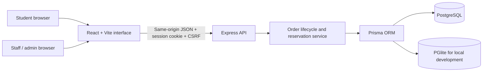
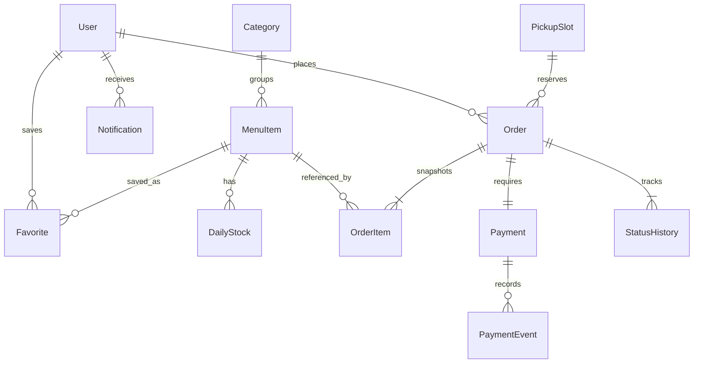
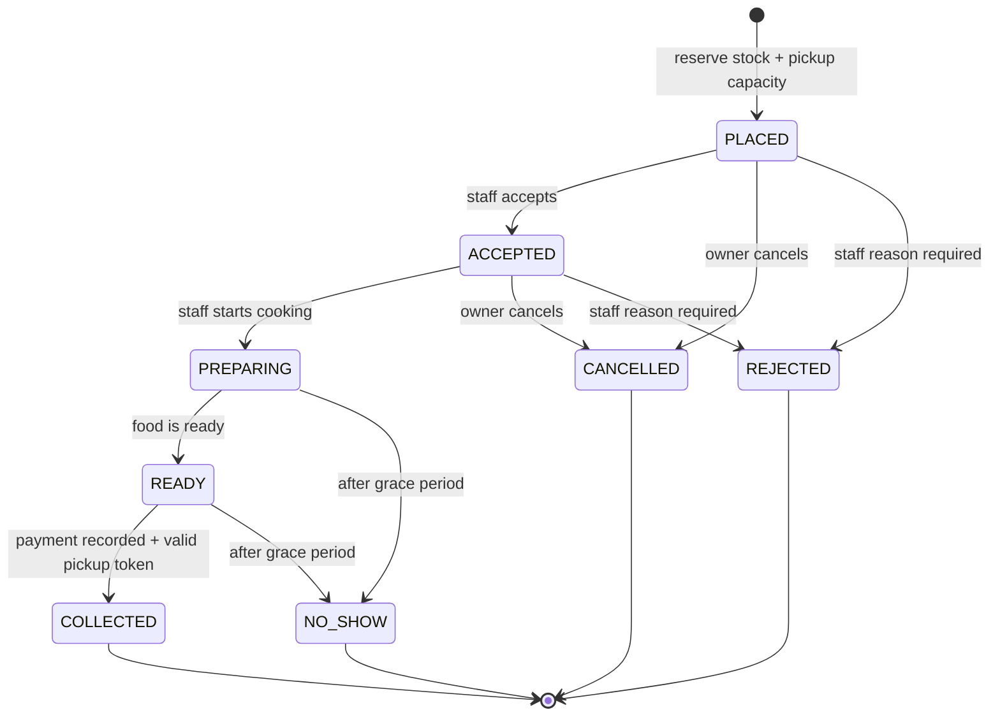

# College project notes

## Abstract

CampusBite is a web application that reduces congestion at a college canteen by letting students browse a digital menu and reserve a same-day meal pickup. Students receive a secure order pass and follow preparation progress, while canteen staff manage stock, preparation, payment collection, and handover. An admin workspace manages menus, pickup schedules, staff accounts, and sales reports. React provides a responsive interface; an Express API applies authentication and business rules; Prisma and PostgreSQL provide durable relational storage. Transactional reservations prevent overselling during busy breaks. The initial system supports one canteen and pay-at-pickup payments.

## Architecture

## ER diagram

Sessions are persisted independently in Session with an expiry and session data. CanteenSettings is a singleton. StatusHistory, PaymentEvent and AuditLog record actor IDs and timestamps.

## Order flow

Cancellation/rejection restores uncooked stock and capacity exactly once. No-show food is not returned to stock. Paid orders cannot be cancelled through the MVP because no refund integration is enabled.

## Future scope

Verified college email, multi-canteen selection, camera QR scanning, genuine online payment/refund processing, push notifications, automatic no-show jobs, demand forecasting, and shared rate-limit infrastructure. These are proposed extensions, not claimed existing features.
